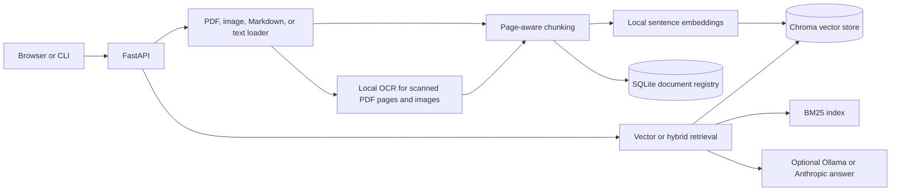

# DocuMind

DocuMind is a local-first document Q&A system. It loads PDFs, common image files, Markdown, and text files, retrieves relevant passages with citations, and can optionally draft grounded answers using an LLM.

## Development setup

Requires Python 3.11 or newer and [uv](https://docs.astral.sh/uv/).

```powershell
uv sync --extra dev
uv run pytest
uv run ruff check .
uv run mypy
```

## Web app

Start the local API and web interface together, then open `http://127.0.0.1:8000`:

```powershell
uv run uvicorn documind.api.main:app --reload
```

Drop in or browse for PDF, PNG, JPG, BMP, TIFF, Markdown, and text files, then search your local library. Images are OCRed locally. The **Extract and copy PDF text** tool lets you choose pages (for example, `1, 3-5`) from a PDF on your computer, then copy each page's text separately. Scanned pages use local OCR. The PDF is processed temporarily and is not added to your library; up to 20 pages can be extracted at a time. Turn on **Generate a grounded answer** to use the configured LLM. The selected provider receives the question and retrieved passages. Answers cite numbered source cards; select a citation to highlight its passage. The page adapts to narrow screens and the operating system's light or dark appearance setting. API docs are at `http://127.0.0.1:8000/docs`.

## Run with Docker Compose

Install Docker Desktop, then from the project folder copy the example settings and start the app:

```powershell
Copy-Item .env.example .env
docker compose up --build
```

Open `http://127.0.0.1:8000`. The first build installs the Python packages and Tesseract; first use also downloads the embedding model. Compose keeps uploaded documents, Chroma data, SQLite metadata, and downloaded embedding models in named volumes so they survive container restarts. Stop the app with `Ctrl+C`; `docker compose down` stops and removes the container while keeping those volumes.

The container listens only on your own computer. Ollama, if selected, runs on Windows outside Docker; set `DOCUMIND_OLLAMA_URL=http://host.docker.internal:11434` in `.env` so the container can reach it. Anthropic remains optional and can incur API charges if enabled. The app has no accounts: it is intended for your local use and should not be exposed as a public document service.

## GitHub showcase

The `docs/` folder is a static preview for GitHub Pages. It uses built-in sample text and does not connect to the API or include your private library. Once this project is pushed to a GitHub repository, set **Settings → Pages → Build and deployment → Source** to **GitHub Actions**. The workflow publishes the preview at `https://<owner>.github.io/<repository>/` after a push to `main`. The real app remains local because it has no accounts and is not safe to share as a public service.

Local development without Docker remains available using the `uv` command above.

## Retrieval CLI

```powershell
uv run documind ingest path\to\document.pdf
uv run documind search "What does this document say?"
uv run documind ask "What does this document say?"
uv run documind ask --llm "What does this document say?"
uv run documind list
uv run documind delete <document-id>
```

The first real embedding may download the configured model (`all-MiniLM-L6-v2`). It loads only when ingestion or search first needs it. Vector search omits results below the configured score threshold; hybrid search ranks dense and keyword matches by their fused rank.

## Scanned PDFs and OCR

PDF OCR is enabled by default for pages that contain an image but have very little extractable text. Standalone PNG, JPG/JPEG, BMP, and TIFF images are OCRed as well. OCR runs locally through PyMuPDF and Tesseract; it is separate from the optional Ollama or Anthropic answer model. Install Tesseract OCR with the language data you need (English is `eng`), then ingest the files again. PyMuPDF's [OCR setup notes](https://pymupdf.readthedocs.io/en/latest/installation.html#enabling-integrated-ocr-support) explain how to install language data and set `DOCUMIND_OCR_TESSDATA` if automatic discovery does not work.

Set `DOCUMIND_OCR_LANGUAGE=eng` for English, or use a `+`-separated language list such as `eng+fra`. To turn OCR off, set `DOCUMIND_OCR_ENABLED=false`. OCR does not send document contents over the network.

## Hybrid search and evaluation

The default `DOCUMIND_SEARCH_MODE=vector` keeps the semantic-search baseline. Set it to `hybrid` to combine vector and BM25 keyword rankings with Reciprocal Rank Fusion for CLI, API, and Q&A retrieval. The BM25 index refreshes when the stored chunk set changes. To rerank hybrid candidates with a cross-encoder, set `DOCUMIND_RERANKER_MODEL=cross-encoder/ms-marco-MiniLM-L-6-v2`; its model loads on the first search and may download at that point.

Run the reproducible evaluation against the bundled multi-page sample PDFs:

```powershell
uv run python eval/run_eval.py
uv run python eval/run_eval.py --rerank
```

The evaluation builds a temporary index, so it does not use or modify `data/`. The optional cross-encoder reranker may download its model the first time. Each question has one expected filename and page; Recall@k reports the fraction with that source in the first *k* results, and MRR averages the reciprocal rank of the first correct source.

Measured on the bundled 18-question sample set:

| Method | Recall@1 | Recall@3 | Recall@5 | MRR |
| --- | ---: | ---: | ---: | ---: |
| Vector baseline | 0.944 | 1.000 | 1.000 | 0.972 |
| Hybrid (BM25 + RRF) | 0.944 | 1.000 | 1.000 | 0.972 |
| Hybrid + cross-encoder | 1.000 | 1.000 | 1.000 | 1.000 |

This small, hand-written sample set shows no change from hybrid fusion and a one-question improvement from reranking. Treat it as a working example of the evaluation workflow, not evidence that these rankings generalize to a larger document collection.

## REST API

The API provides `GET /health`, `POST /documents`, `POST /extract-text`, `GET /documents`, `DELETE /documents/{id}`, `POST /search`, and `POST /ask`. Uploads accept PDF, PNG, JPG/JPEG, BMP, TIFF, Markdown, and text files up to `DOCUMIND_MAX_UPLOAD_MB` (25 MB by default). CORS is disabled by default. The API has no authentication and is intended to stay on localhost.

PowerShell examples:

```powershell
Invoke-RestMethod http://127.0.0.1:8000/documents -Method Post `
  -Form @{ file = Get-Item "C:\docs\notes.pdf" }

$body = @{ query = "What is the main idea?"; top_k = 5 } | ConvertTo-Json
Invoke-RestMethod http://127.0.0.1:8000/search -Method Post `
  -ContentType "application/json" -Body $body

$body = @{ query = "What is the main idea?"; top_k = 5; use_llm = $false } | ConvertTo-Json
Invoke-RestMethod http://127.0.0.1:8000/ask -Method Post `
  -ContentType "application/json" -Body $body
```

## Architecture



## LLM configuration

LLM use is disabled by default. Set `DOCUMIND_LLM_PROVIDER=ollama` for local Ollama or `DOCUMIND_LLM_PROVIDER=anthropic` for Anthropic's API. The Anthropic provider reads `ANTHROPIC_API_KEY` from the environment or ignored `.env` file. Search continues to work without either provider. When LLM use is enabled, retrieved passages are sent to the selected provider.

## Configuration

Settings are loaded from environment variables and `.env`. `.env.example` lists the supported settings; `.env` and the local `data/` directory are ignored by Git. DocuMind application logs are JSON lines on standard output; `DOCUMIND_LOG_LEVEL` controls their verbosity.

## Limitations and next improvements

- OCR runs on image-heavy PDF pages and standalone images, and depends on installed Tesseract language data. The container includes English OCR data; install other language packs to use other languages.
- Embedding and reranker models run locally and may require significant memory and disk space on first use.
- The benchmark is small and hand-written; expand it with questions from real, permitted sample documents before drawing conclusions about retrieval quality.
- The web API does not include authentication. Keep it bound to localhost. The GitHub Pages showcase is a static sample and does not connect to the API or contain personal documents.
- Future improvements could add document filters, better multilingual OCR, streaming answers, and a larger held-out retrieval evaluation.

## Project status

Phase 10: local document Q&A, local OCR, and a static GitHub Pages showcase. The showcase uses sample content and does not expose the personal document library.
